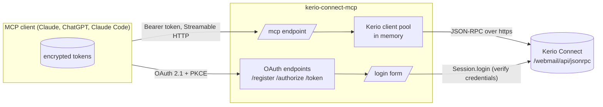
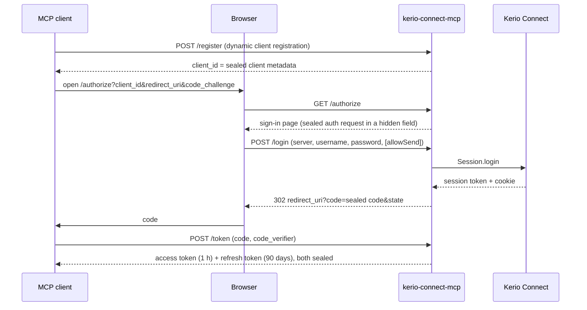

# Architecture

## Overview

The server has two transports:

- **http** (deployment): a remote MCP endpoint. Every user signs in with their own Kerio server, username and password.
  The server configuration contains no Kerio credentials.
- **stdio** (local use): one mailbox configured through environment variables, for MCP clients that start the server
  as a local process.

## Source layout

| File | Responsibility |
|---|---|
| `src/index.ts` | Entry point: loads configuration and starts the stdio or http transport |
| `src/config.ts` | Environment parsing and validation (strict boolean switches, token key) |
| `src/mcp-server.ts` | MCP server for one mailbox connection: tool list and tool dispatch |
| `src/mail-tools.ts` | Tool schemas, descriptions, search/paging logic and response formatting |
| `src/client.ts` | Kerio JSON-RPC client: method allowlist, session handling, retries, send outcome |
| `src/network.ts` | Outbound policy: https only, host allowlist, private address blocking, TLS trust |
| `src/http-server.ts` | Express app: OAuth router, sign-in form handler, `/mcp`, `/healthz`, Kerio client pool |
| `src/oauth-provider.ts` | Stateless OAuth provider: client registration, codes, access and refresh tokens |
| `src/sealed-token.ts` | AES-256-GCM sealing of all OAuth artifacts |
| `src/login-page.ts` | Sign-in page (English with a CSS-only Czech switch) and error page |
| `src/tool-arguments.ts` | Tolerant conversion of stringified tool arguments |
| `src/types.ts` | Types of the Kerio API structures used |

## Request flow

### Signing in

Credentials are checked against Kerio before any code is issued. The code, the access token and the refresh token each
carry the credentials and the send permission, encrypted.

### Calling a tool

1. The client sends `POST /mcp` with `Authorization: Bearer <access token>`.
2. The bearer middleware opens the token; invalid, foreign, tampered or expired tokens get `401` with a
   `WWW-Authenticate` header pointing to the OAuth metadata.
3. The server takes the Kerio client for these credentials from the in-memory pool (or creates one) and builds an MCP
   server whose tool list depends on the connection's send permission.
4. The tool calls Kerio. The Kerio session is reused across requests; if it expired, the client signs in again.

The MCP endpoint is stateless (no MCP sessions): every request is self-contained, so restarts and multiple instances
need no shared state.

## Stateless design

Nothing is persisted:

| Artifact | Where it lives | Lifetime |
|---|---|---|
| Client registration | the `client_id` itself (sealed) | unlimited |
| Pending sign-in | hidden form field (sealed) | 15 minutes |
| Authorization code | redirect URL (sealed); redeemed codes are remembered in memory until they expire | 5 minutes, single use |
| Access token | MCP client | 1 hour |
| Refresh token | MCP client; a new one is issued on every refresh | 90 days from last refresh |
| Kerio client and session | server memory | evicted after 30 minutes idle |

Each sealed artifact type uses its own associated data, so a refresh token is never accepted as an access token and so on.
Losing server memory (restart, deploy) only costs one extra Kerio sign-in on the next request.

## Kerio API usage

| Method | Used for |
|---|---|
| `Session.login` | Signing in; returns the `X-Token`, the `SESSION_CONNECT_WEBMAIL` cookie is taken from `Set-Cookie` |
| `Folders.get` | Listing mail folders (type `FMail`) |
| `Mails.get` | Search pages: `folderIds`, `start`, `limit`, order by `receiveDate` descending, optional `QUICKSEARCH` condition; returns `totalItems` |
| `Mails.getById` | Reading one message with its displayable parts |
| `Mails.create` | Sending (only with sending enabled; one message with `send: true`) |

Reference: [Kerio Connect client API](https://manuals.gfi.com/en/kerio/api/connect/client/reference/index.html).
Assumptions that are not documented by Kerio are listed in [Verification](verification.md).
